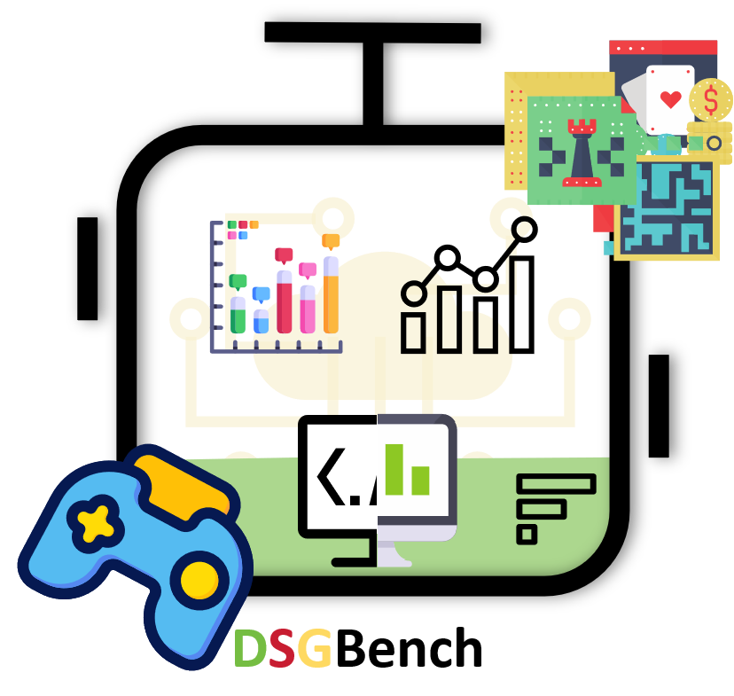

---
hide:
  - toc
  - navigation
---

<div class="hero-section">
  <div class="hero-logo">
    
  </div>
  <h1 class="hero-title">
    <span class="brand-d">D</span><span class="brand-s">S</span><span class="brand-g">G</span>Bench<span class="brand-plus">++</span>
  </h1>
  <p class="hero-subtitle">
    A Closed-Loop Infrastructure for Agentic Strategic Decision-Making — Evaluation, Trajectory Collection, and RL Training
  </p>
  <p class="hero-tagline">
    "In the agentic era, true intelligence is forged not in isolated tests, but in the continuous loop of decision, feedback, and growth."
  </p>
  <div class="hero-stats">
    <div class="stat-item">
      <span class="stat-number">6</span>
      <span class="stat-label">Game Environments</span>
    </div>
    <div class="stat-item">
      <span class="stat-number">4</span>
      <span class="stat-label">Core Modules</span>
    </div>
    <div class="stat-item">
      <span class="stat-number">10+</span>
      <span class="stat-label">LLMs Evaluated</span>
    </div>
    <div class="stat-item">
      <span class="stat-number">∞</span>
      <span class="stat-label">Closed-Loop</span>
    </div>
  </div>
  <div class="hero-buttons">
    <a href="https://arxiv.org/abs/2503.06047" class="btn btn-primary">📄 Paper (arXiv)</a>
    <a href="https://github.com/DeciBrain-Group/DSGBench" class="btn btn-secondary">💻 GitHub</a>
    <a href="getting_started/quickstart/" class="btn btn-secondary">🚀 Quick Start</a>
    <a href="dsgbench/leaderboard/" class="btn btn-secondary">🏆 Leaderboard</a>
  </div>
</div>

## What is DSGBench++?

**DSGBench++** is a full **closed-loop infrastructure** for building, evaluating, and training LLM-based strategic decision-making agents.
Built on top of [DSGBench](https://arxiv.org/abs/2503.06047), it extends the benchmark into a system covering the entire agent development lifecycle:

<div class="system-overview">
  <div class="module-card">
    <h4>🏗️ Environment Construction</h4>
    <p>Six diverse strategic game environments with OpenAI Gym-compatible interfaces, covering real-time and turn-based scenarios</p>
  </div>
  <div class="module-card">
    <h4>📊 Agent Evaluation</h4>
    <p>Fine-grained multi-dimensional metrics for strategic planning, real-time decision quality, and multi-agent interaction</p>
  </div>
  <div class="module-card">
    <h4>🗂️ Trajectory Collection</h4>
    <p>Structured capture and organization of every agent decision as JSON records — the core asset for SFT and RL</p>
  </div>
  <div class="module-card">
    <h4>🤖 RL Training</h4>
    <p>Reinforcement learning pipelines (GRPO/PPO) that leverage game feedback and collected trajectories to iteratively improve agents</p>
  </div>
</div>

## Game Environments

Six high-dynamics strategic games spanning real-time and turn-based, perfect and imperfect information scenarios:

<div class="game-grid">
  <div class="game-card">
    <div class="game-icon">⚔️</div>
    <h3>StarCraft II</h3>
    <div class="badge-row">
      <span class="badge badge-realtime">Real-time</span>
      <span class="badge badge-imperfect">Imperfect Info</span>
    </div>
    <p>Real-time strategy demanding resource management, base building, and army control under fog of war. The gold standard for complex strategic AI.</p>
    <a href="environments/starcraft2/starcraft2/">Learn More →</a>
  </div>
  <div class="game-card">
    <div class="game-icon">🏛️</div>
    <h3>Civilization</h3>
    <div class="badge-row">
      <span class="badge badge-turnbased">Turn-based</span>
      <span class="badge badge-imperfect">Imperfect Info</span>
    </div>
    <p>4X strategy with city management, diplomacy, and technology trees. Tests long-horizon planning across hundreds of turns.</p>
    <a href="environments/civ/civ/">Learn More →</a>
  </div>
  <div class="game-card">
    <div class="game-icon">🥊</div>
    <h3>Street Fighter III</h3>
    <div class="badge-row">
      <span class="badge badge-realtime">Real-time</span>
      <span class="badge badge-perfect">Perfect Info</span>
    </div>
    <p>Fast-paced fighting game testing real-time reaction speed and frame-level tactical decision-making under time pressure.</p>
    <a href="environments/street_fighter/street_fighter/">Learn More →</a>
  </div>
  <div class="game-card">
    <div class="game-icon">🌍</div>
    <h3>Diplomacy</h3>
    <div class="badge-row">
      <span class="badge badge-turnbased">Turn-based</span>
      <span class="badge badge-perfect">Perfect Info</span>
    </div>
    <p>Multi-player negotiation game requiring alliance formation, strategic betrayal, and simultaneous multi-agent coordination.</p>
    <a href="environments/diplomacy/diplomacy/">Learn More →</a>
  </div>
  <div class="game-card">
    <div class="game-icon">🐺</div>
    <h3>Werewolf</h3>
    <div class="badge-row">
      <span class="badge badge-turnbased">Turn-based</span>
      <span class="badge badge-imperfect">Imperfect Info</span>
    </div>
    <p>Social deduction game challenging agents with deception, persuasion, and reasoning about hidden roles under uncertainty.</p>
    <a href="environments/werewolf/werewolf/">Learn More →</a>
  </div>
  <div class="game-card">
    <div class="game-icon">🗺️</div>
    <h3>Stratego</h3>
    <div class="badge-row">
      <span class="badge badge-turnbased">Turn-based</span>
      <span class="badge badge-imperfect">Imperfect Info</span>
    </div>
    <p>Strategic board game with hidden piece strengths, requiring bluffing, positional strategy, and opponent modeling.</p>
    <a href="environments/stratego/stratego/">Learn More →</a>
  </div>
</div>

## DSGBench vs DSGBench++

| Feature | DSGBench (v1) | DSGBench++ |
|---------|:---:|:---:|
| 6 Game Environments | ✅ | ✅ |
| Multi-dimensional Evaluation | ✅ | ✅ Enhanced |
| OpenAI Gym Interface | ✅ | ✅ |
| Structured Trajectory Collection | ❌ | ✅ |
| Trajectory Visualization | ❌ | ✅ |
| SFT Data Pipeline | ❌ | ✅ |
| RL Training Loop (GRPO/PPO) | ❌ | ✅ |
| Closed-Loop Design | ❌ | ✅ |
| Elo Rating System | ❌ | 🔜 Planned |
| Community Extension API | ❌ | 🔜 Planned |

## Citation

If you use DSGBench in your research, please cite:

```bibtex
@misc{tang2025dsgbenchdiversestrategicgame,
      title={DSGBench: A Diverse Strategic Game Benchmark for Evaluating
             LLM-based Agents in Complex Decision-Making Environments},
      author={Wenjie Tang and Yuan Zhou and Erqiang Xu and Keyan Cheng
              and Minne Li and Liquan Xiao},
      year={2025},
      eprint={2503.06047},
      archivePrefix={arXiv},
      primaryClass={cs.AI},
      url={https://arxiv.org/abs/2503.06047}
}
```
